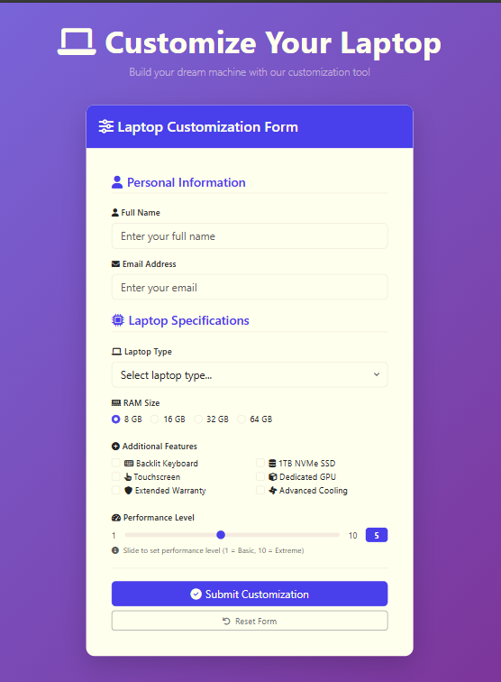

# 💻 Laptop Customization Form

A modern and responsive laptop customization form that allows users to configure their preferred laptop specifications and performance options through an intuitive web interface.

## 📌 Overview

This project was developed as a front-end web development project to practice building interactive forms and creating clean, user-friendly interfaces.

Users can enter their personal information, select a laptop type, choose RAM size, enable additional features, and adjust the desired performance level.

## ✨ Features

- 👤 Personal information input
- 💻 Laptop type selection
- 🧠 RAM size selection
- ⚙️ Additional laptop features
- 🎚️ Adjustable performance level
- 🔄 Reset form functionality
- 📱 Responsive design
- 🎨 Clean and modern user interface
- ✅ Interactive form controls

## 🛠️ Technologies Used

- HTML5
- CSS3
- JavaScript
- Bootstrap
- Font Awesome

## 📷 Preview



🎯 Purpose
The main goal of this project was to practice:
- Building structured HTML forms
- Creating responsive layouts
- Styling modern user interfaces
- Handling user input with JavaScript
- Creating interactive form elements
- Using Bootstrap components and utilities
👨‍💻 Author
Mohamed Hatem Abdalaal
Computer Science Student
Minia University
⭐ If you like this project, feel free to give it a star!


```bash
git clone https://github.com/your-username/laptop-customization-form.git
